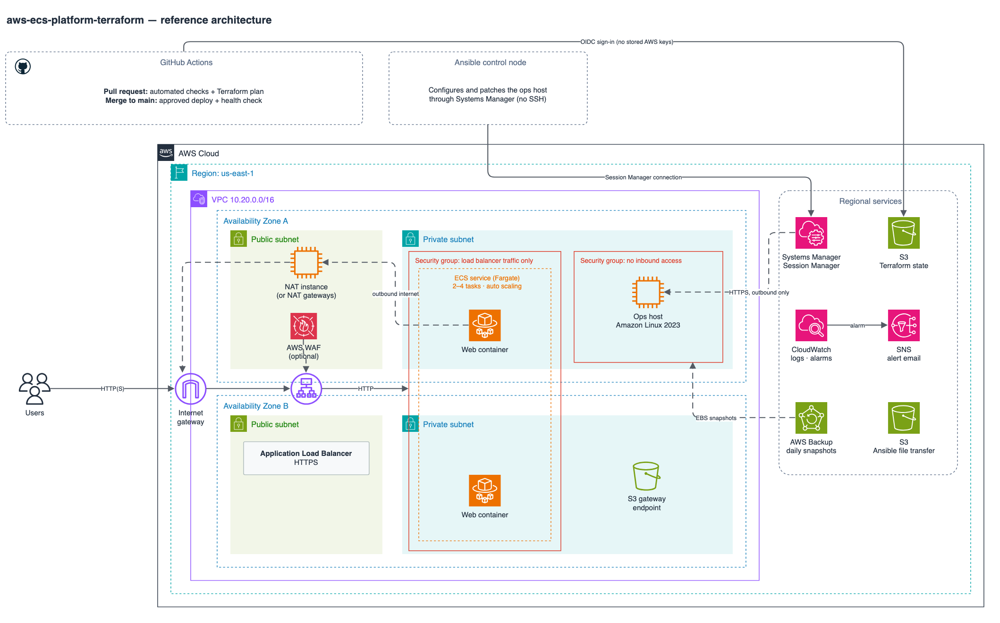

# AWS ECS Platform — Terraform + Ansible

A reference AWS environment that shows how I structure infrastructure as code and operations work end to end:
a two-AZ VPC, an ECS Fargate service behind an Application Load Balancer, a hardened Linux host configured by
Ansible over AWS Systems Manager, backups, alarms, and a GitHub Actions pipeline that plans and applies Terraform
through OIDC with no stored AWS keys.



*Editable source: [docs/architecture.drawio](docs/architecture.drawio)*

## What it covers

| Area | Implementation |
|------|----------------|
| Infrastructure as code | Terraform modules for network, load balancer, ECS service, ops host, backup, and monitoring; S3 remote state with native lockfile |
| Networking | VPC across 2 AZs, public/private subnets, NAT instance *or* NAT gateway per AZ, S3 gateway endpoint, optional interface endpoints, VPC flow logs |
| Containers | ECS on Fargate (Graviton/ARM64), rolling deploys with the circuit breaker and automatic rollback, CPU target-tracking autoscaling |
| Linux administration | Amazon Linux 2023 host configured by Ansible: packages, time sync, journald retention, SSH and kernel hardening, auditd rules, CloudWatch agent |
| Patching | `patch.yml` applies security updates one host at a time and reboots only when `dnf needs-restarting` says so |
| Access | Systems Manager Session Manager only: no SSH keys, no inbound security group rules, no bastion |
| Backup | AWS Backup daily plan selecting resources by the `Backup=daily` tag |
| Monitoring | CloudWatch alarms (5xx, unhealthy targets, ECS CPU, EC2 status checks) to SNS email; Container Insights |
| Security | Least-privilege security groups, IMDSv2, encrypted volumes and buckets, TLS 1.3 listener policy, optional AWS WAF with managed rules and per-IP rate limiting |
| CI/CD | GitHub Actions: `fmt`, `validate`, `tflint`, Checkov, and a plan posted to the pull request; apply on `main` behind a protected environment, then a smoke test |

## Design decisions

- **NAT instance by default, NAT gateway when it matters.** `nat_mode = "instance"` runs one `t4g.nano` NAT instance
  for about $3/month instead of roughly $33/month per managed NAT gateway. It is a single point of failure for
  outbound traffic, so production would use `nat_mode = "gateway"`, which creates one gateway per AZ.
- **Two deploy roles.** Pull requests assume a read-only plan role. Only jobs in the protected `dev` GitHub
  environment (required reviewers) can assume the apply role. Both trust policies are pinned to this repository
  through GitHub's OIDC `sub` claim.
- **No SSH anywhere.** Ansible connects through the `amazon.aws.aws_ssm` connection plugin, so the ops host has no
  key pair and its security group has no inbound rules. Session Manager is also the break-glass shell.
- **Patch in place.** The ops host ignores AMI changes in Terraform, and Ansible applies security updates from the
  latest Amazon Linux 2023 release instead of replacing the instance on every new AMI.
- **S3-native state locking.** Terraform 1.10+ locks state with a lockfile in S3, so no DynamoDB table is needed.
- **Every scanner exception is explained.** Checkov runs in CI; each skipped check has its reason written next to the
  resource (for example, AWS-managed instead of customer-managed KMS keys to keep a lab cheap).

## Repository layout

```
bootstrap/            one-time: state bucket, GitHub OIDC provider, plan and apply roles
envs/dev/             the dev environment that composes the modules
modules/
  network/            VPC, subnets, NAT, endpoints, flow logs
  alb/                load balancer, listeners, optional WAF
  ecs-service/        cluster, task definition, service, IAM, autoscaling
  ops-host/           Linux host managed over SSM + Ansible transfer bucket
  backup/             AWS Backup vault, plan, tag-based selection
  monitoring/         SNS topic and CloudWatch alarms
ansible/
  site.yml            baseline, hardening, and CloudWatch agent roles
  patch.yml           rolling security patching
  inventory/          aws_ec2 dynamic inventory + SSM connection settings
.github/workflows/    Terraform and Ansible pipelines
```

## Deploy it

Prerequisites: an AWS account, AWS CLI v2, Terraform ≥ 1.10, Python 3, and the
[Session Manager plugin](https://docs.aws.amazon.com/systems-manager/latest/userguide/session-manager-working-with-install-plugin.html).

**1. Bootstrap (once, with administrator credentials)**

```bash
cd bootstrap
terraform init
terraform apply -var github_repository=<owner>/<repo>
```

**2. Deploy the dev environment**

```bash
cd envs/dev
cp backend.hcl.example backend.hcl            # set bucket to the bootstrap output state_bucket
terraform init -backend-config=backend.hcl
terraform apply
terraform output app_url                      # open it once the tasks pass health checks
```

**3. Configure the ops host with Ansible**

```bash
cd ansible
python3 -m pip install ansible-core boto3
ansible-galaxy collection install -r requirements.yml
export ANSIBLE_SSM_BUCKET="$(terraform -chdir=../envs/dev output -raw ansible_ssm_bucket)"
ansible-inventory --graph                     # the host appears under role_ops
ansible-playbook site.yml
ansible-playbook patch.yml
```

**4. Turn on the pipeline**

Add repository variables `AWS_REGION`, `TF_STATE_BUCKET`, `AWS_PLAN_ROLE_ARN`, and `AWS_APPLY_ROLE_ARN`
(from the bootstrap outputs), and create a `dev` environment with required reviewers. Until the variables exist,
the pipeline runs only the checks.

**5. Tear down**

```bash
cd envs/dev && terraform destroy
```

The state bucket has `prevent_destroy`; empty and delete it by hand if you are finished with the project.

## Cost

Approximate on-demand prices in us-east-1 with the defaults, if left running for a month:

| Item | ~USD/month |
|------|-----------:|
| Application Load Balancer (hourly + light LCU use) | 17–22 |
| 2 Fargate tasks, 0.25 vCPU / 0.5 GB, ARM64 | 14 |
| Public IPv4 addresses (load balancer ×2, NAT instance) | 11 |
| Ops host `t4g.micro` + NAT instance `t4g.nano` | 9 |
| CloudWatch (detailed monitoring, Container Insights, logs, alarms) | 5–8 |
| EBS volumes and backup snapshots | 3 |
| **Total** | **≈ 60** |

That is roughly 9 cents an hour, so deploying, testing, and destroying it in an afternoon costs well under a dollar.
`nat_mode = "gateway"` adds about $66/month (two gateways), interface endpoints about $7/month each per AZ, and
WAF about $10/month. Check current prices with the [AWS Pricing Calculator](https://calculator.aws/).

## Taking it to production

- A separate `envs/prod` with `nat_mode = "gateway"`, deletion protection, and longer log and backup retention
- Customer-managed KMS keys for logs, backups, and buckets
- Load balancer access logs and WAF logging
- An apply role scoped to the services in use, with a permissions boundary
- A container image pipeline (build, scan, push to ECR) instead of the public nginx image

## License

[MIT](LICENSE)
